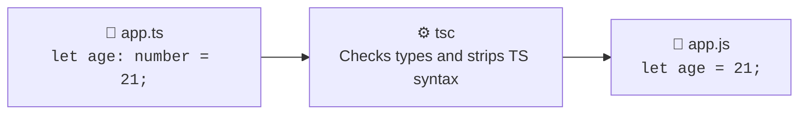
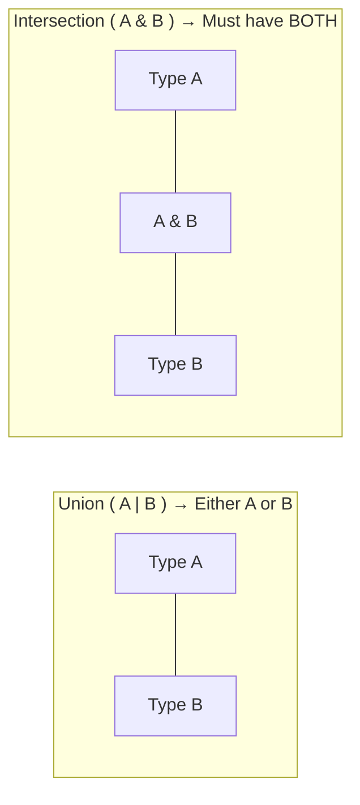
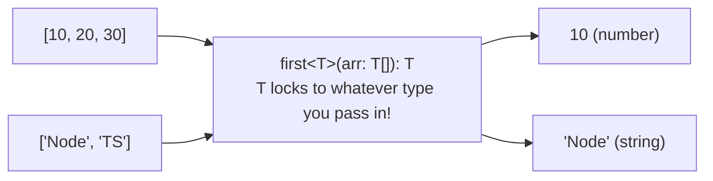

# TypeScript Advanced
## Session 1 — *Hello, World!*

---

## ️ Agenda

### Part 1
| # | Topic |
|:-:|-------|
| 01 | What is TypeScript |
| 02 | TypeScript Basics |
| 03 | More TypeScript |
| 04 | Hands-On & Break ☕ |

### Part 2
| # | Topic | Covers |
|:-:|-------|--------|
| 01 | **More TypeScript (cont.)** | `void` & `never`, `any` & `unknown` · Type casting with `as` · Non-null assertion `!` and optional chaining `?.` · Type narrowing, type guards, the `in` operator & the `keyof` keyword |
| 02 | **Generics & Utility Types** | Reusable, flexible types · Useful built-in utility types · Generic functions, interfaces & constraints |
| 03 | **OOP in TypeScript** | Classes & objects · Access modifiers and abstract classes · Constructors, inheritance & encapsulation |

---

# 📌 Part 1

## Who here hates JS?

### JS development

> - JavaScript is awesome for building things, but it can get **chaotic**.
> - Suddenly you're debugging for hours, and the bug?
> - Something JS didn't warn you about until it **exploded at runtime**.

---

## The Checkout Bug

Look at this Express service.
**No red squiggles. No build error.**
It only explodes when a real guest checks out.

```js
function checkout(order, user) {
  const net = order.total - order.discount;
  console.log(user.profile.email); // 💥 TypeError!
  return net + order.shippingFee;  // 💥 "18030"!
}

checkout(
  { total: 200, discount: 20, shippingFee: "30" },
  {}
);
```

---

## ️ JS vs TS — Same Function

<table>
<tr>
<th>🟨 JavaScript — accepts wrong types silently</th>
<th>🟦 TypeScript — blocks wrong types while you type</th>
</tr>
<tr>
<td>

```js
function calcArea(l, w) {
  return l * w;
}

calcArea(2, 3);    // 6
calcArea(2, "3");  // 6 (weird!)
calcArea(2, "hi"); // NaN
```

</td>
<td>

```ts
function calcArea(l: number, w: number) {
  return l * w;
}

calcArea(2, 3);   // OK ✅
calcArea(2, "3"); // Error! ❌
```

</td>
</tr>
</table>

---

## Airbnb Production Study

# 38%
**Preventable production bugs**

> *"Airbnb found that 38% of their production JavaScript bugs could have been caught by TypeScript."*

🔥 *"This is fine."* 🔥

---

## How was this problem fixed?

### TypeScript was the answer

**Microsoft introduced TypeScript as a solution:**

- ✔️ Code is **safe** and **type annotated**
- ✔️ Bugs appear **early** in compile time
- ✔️ Maintaining **large projects** became easier

---

# What is TypeScript?

## TypeScript, JavaScript's cousin

> TypeScript is a **superset of JavaScript**, where it includes **static types**, and is **strongly typed**, and can also be **loosely typed**.

> **Note:**
> TypeScript isn't traditionally compiled into machine code, but rather **transpiled** (source-to-source compilation) into JavaScript — **but why?**

---

## What Does Transpilation Mean?

*Source-to-source translation between languages at the same abstraction level.*



| Stage | What happens |
|-------|--------------|
| **High-level source** | `app.ts` → `let age: number = 21;` |
| **Transpiler** | `tsc` — checks types and strips TS syntax |
| **High-level output** | `app.js` → `let age = 21;` |

---

## Why Transpiled?

| ❌ Option A — Build a brand-new TS runtime | ✅ Option B — Transpile TS into JavaScript |
|---|---|
| Every browser needs a new engine | Runs everywhere JS runs |
| Breaks the whole npm ecosystem | 100% npm & Node compatible |
| Not practical for the web | Zero lock-in — adopt gradually |

---

## 🔁 Technologies That Transpile

| Source | | Output | What happens |
|:------:|:-:|:------:|--------------|
| **Sass** | → | **CSS** | Variables, nesting & mixins converted to CSS |
| **TypeScript** | → | **JavaScript** | Static types & interfaces erased to JS |
| **JSX** | → | **JavaScript** | HTML-like UI syntax converted to JS calls |

---

## ️ Compilation vs. Interpretation vs. Transpilation

| | **Compilation** | **Interpretation** | **Transpilation** |
|---|---|---|---|
| **Output** | Low-level machine code | Executed directly line-by-line | Another high-level language |
| **Checks** | Errors caught before running | Errors hit at runtime | Validated before code emit |
| **Examples** | C++, Go, Rust | Python, Bash, Classic JS | TypeScript, Sass, JSX |

---

## Dynamic vs Static Typing

| | Definition | Examples |
|---|---|---|
| **Dynamic Typing** | Type checking happens at **runtime**, not during compilation | Python, JavaScript |
| **Static Typing** | Type checking happens **while writing code**, so errors appear early on | C++, Java |

---

## ‍☠️ Quick Quest

> **Why do we say "compile time" even though JS is interpreted — and what is an LSP?**
>
> 🎁 *Bonus Mohsens for the right answer!*

<details>
<summary>💡 Click to reveal the answer</summary>

- **"Compile time"** here really means **"before the code runs"**. The TypeScript checker (`tsc`) analyzes your code and reports type errors *before* it's ever executed as JS. JS itself is still interpreted/JIT-ed at runtime — the checking just happens earlier, in the TS → JS step.
- **LSP = Language Server Protocol.** A standard protocol between an editor and a "language server" (for TS: `tsserver`) that powers autocomplete, go-to-definition, and the **red squiggles** while you type.

</details>

---

# How to Run TypeScript

## ️ Setting Up TypeScript

| Step | Action | Command | What it does |
|:----:|--------|---------|--------------|
| **01** | Initialize Project | `npm init -y` | Creates `package.json` manifest |
| **02** | Install TypeScript | `npm i -D typescript` | Adds compiler as devDependency |
| **03** | Create Config | `tsc --init` | Generates default `tsconfig.json` |

---

## Running TypeScript: `tsc` vs `tsx`

<table>
<tr>
<th>🟧 tsc — Compile Then Run</th>
<th>🟨 tsx — Execute Directly</th>
</tr>
<tr>
<td>

```bash
tsc index.ts
node index.js
```

</td>
<td>

```bash
tsx index.ts
```

</td>
</tr>
<tr>
<td>

- **Type Checks:** Validates all types before emit
- **Emits Files:** Outputs plain JS to `dist/`
- **Best For:** Production builds and CI checks

</td>
<td>

- **Instant Speed:** Powered by esbuild without emit
- **No Type Check:** Strips types for fast startup
- **Best For:** Local development and quick scripts

</td>
</tr>
</table>

---

## ️ Understanding `tsconfig.json`

> **What is tsconfig?**
> `tsconfig.json` is the configuration file that tells the TypeScript compiler (`tsc`) how to handle your project.

> **Why it matters**
> It ensures TypeScript checks, compiles, and organizes your project consistently according to your chosen configuration.

### Important tsconfig Options

| Option | Example | What It Controls |
|--------|---------|------------------|
| `target` | `"ES2022"` | JavaScript version of emitted output |
| `module` | `"NodeNext"` | Generated import/export module system |
| `strict` | `true` | Enables all core type-safety checks |
| `rootDir` | `"./src"` | Root folder for TypeScript source files |
| `outDir` | `"./dist"` | Destination folder for compiled JS |
| `moduleResolution` | `"NodeNext"` | How TypeScript resolves import paths |

---

# TypeScript Basics

> *Let's write real code.*

## Variables: Primitives

> Always use **lowercase** types: `string`, `number`, `boolean`.
> **Never** use capitalized `String`, `Number`, `Boolean` (those are JS wrapper objects).

```ts
let name: string = "Mohsen";
let age: number = 21;
let isCool: boolean = true;

age = "21";   // ❌ Error!
isCool = 1;   // ❌ Error!
```

---

## ️ Annotation vs Inference

<table>
<tr>
<th>✍️ Explicit (Annotation) — you write `: Type` yourself</th>
<th>🪄 Implicit (Inference) — TS guesses the type from the value</th>
</tr>
<tr>
<td>

```ts
let token: string;
const ids: number[] = [];

function add(a: number, b: number) {
  return a + b;
}
```

</td>
<td>

```ts
let port = 3000;     // number
let host = "local";  // string
let isProd = false;  // boolean

port = "8080"; // ❌ Error!
```

</td>
</tr>
<tr>
<td>

👉 Use for **params, empty arrays & delayed vars**.

</td>
<td>

👉 **Cleaner code — exact same safety!**

</td>
</tr>
</table>

---

## Bonus Question!

> **Which of these lines will give a compile error?**
> What do you think the `{}` type actually means in TypeScript? *Guess before we reveal!*

```ts
let a: {} = { name: "Mohsen" };
let b: {} = 42;
let c: {} = "Hello";
let d: {} = null;
let e: {} = undefined;
```

### Answer: What `{}` Really Means!

```ts
let a: {} = { name: "Ali" }; // ✅ OK
let b: {} = 42;              // ✅ OK!
let c: {} = "Hello";         // ✅ OK!
let d: {} = null;            // ❌ Error!
let e: {} = undefined;       // ❌ Error!

// Truly empty object:
let empty: Record<string, never> = {};
```

| Value | Assignable to `{}`? |
|-------|:---:|
| `{ name: "Ali" }` | ✅ |
| `42` (number) | ✅ |
| `"Hello"` (string) | ✅ |
| `true` (boolean) | ✅ |
| `null` | ❌ |
| `undefined` | ❌ |

> **Important:**
> `{}` means **"any non-nullish value"** — NOT an empty object!

---

## Arrays & Tuples

<table>
<tr>
<th>📦 Arrays (any length) — same type for every item</th>
<th>🎯 Tuples (fixed length & order) — each index has its own exact type</th>
</tr>
<tr>
<td>

```ts
const tags: string[] = ["Node", "TS"];
const nums: Array<number> = [1, 2];

tags.push("Docker"); // ✅ OK
tags.push(123);      // ❌ Error!
```

</td>
<td>

```ts
const ok: [number, string] = [200, "OK"];
const bad: [number, string] = ["OK", 200];
// ❌ Error: wrong order!
```

</td>
</tr>
</table>

---

## ️ Enums

> Named constants for fixed choices like roles or committees.
> Prefer **String Enums** over numeric ones so logs stay readable.

```ts
// Numeric (0, 1, 2 — unclear in logs)
enum Priority { Low, Med, High }

// String Enum (clean & readable!)
enum Committee {
  Backend  = "BACKEND",
  Linux    = "LINUX",
  Frontend = "FRONTEND"
}

let team = Committee.Backend;
```

---

## Functions & Return Types

> Always type parameters.
> Use `?` for **optional** arguments and `=` for **default** values.

```ts
function greet(
  name: string,
  role: string = "Member",
  title?: string
): string {
  return `${title ?? ""} ${name} (${role})`;
}

greet("Mohsen");                  // ✅ OK
greet("Mohsen", "Lead", "Eng.");
```

---

## Objects

> Describe object properties inline.
> Use `?` for **optional** fields and `readonly` for IDs that shouldn't change.

```ts
const member: {
  readonly id: number;
  name: string;
  bio?: string;
} = {
  id: 1,
  name: "Mohsen"
};

member.id = 2; // ❌ Error: readonly!
```

---

# More TypeScript

## Literal Types

> Lock a variable to **exact allowed values** instead of any string or number.
> Instant autocomplete + zero typos.

```ts
type Method = "GET" | "POST" | "DELETE";
type Committee = "Backend" | "Linux";

function req(url: string, m: Method) {
  console.log(m, url);
}

req("/users", "GET");   // ✅ OK
req("/users", "PATCH"); // ❌ Error!
```

---

## ️ Type Aliases (`type`)

### *A variable for types*

- **Name Any Type:** Primitives, unions, tuples, or objects
- **Reuse Cleanly:** Share one definition across files
- **Zero Runtime Cost:** Erased completely after compilation

```ts
// Like a variable — storing a type!
type ID = string | number;
type Role = "admin" | "member";

type User = {
  id: ID;
  name: string;
  role: Role;
};

const dev: User = { id: 1, name: "Ali", role: "admin" };
```

---

## 📐 Interfaces

> Think of them like **Structs in C++**.
> Define an object contract once, reuse it everywhere, or extend it.

```ts
interface Member {
  name: string;
  age: number;
  committee: string;
}

interface Board extends Member {
  role: "Head" | "Vice";
}

const m: Member = {
  name: "Mohsen", age: 21, committee: "Backend"
};
```

---

## `type` vs `interface`

| | 📐 `interface` — Object & class contracts | 🏷️ `type` — Any TypeScript type |
|---|---|---|
| Scope | Built for objects & classes | Objects, unions, tuples, primitives |
| Extending | Supports `extends` & `implements` | Great with `\|` and `&` operators |
| Re-opening | Supports **declaration merging** | No accidental re-opening |
| Limits | Can't do unions or primitives | Works directly with Utility Types |

> **Tip:**
> **Quick rule:** `interface` for objects/classes • `type` for unions, literals & aliases.

---

## Unions ( `|` ) vs Intersections ( `&` )

> Either one type **OR** another vs combining **BOTH** together.



### Code

<table>
<tr>
<th>UNION ( | ) — a variable can hold Type A OR Type B</th>
<th>INTERSECTION ( & ) — combines all properties from both types</th>
</tr>
<tr>
<td>

```ts
let id: number | string = 101;
id = "usr_42"; // ✅ OK

type Res =
  | { ok: true;  data: string[] }
  | { ok: false; err: string };
```

</td>
<td>

```ts
type Id   = { id: number };
type Name = { name: string };

type User = Id & Name;

const u: User = { id: 1, name: "Ali" };
```

</td>
</tr>
</table>

---

## Break

> *Take 10 — you earned it.* 😄

---

# 📌 Part 2

## ️ Void

> **Q:** What will this code output and why?

```js
function func() {
  let x = 20;
}
console.log(func());
// ? What is printed?
```

> `void` is a type for functions that return **`undefined`** (i.e. nothing useful).

<details>
<summary>💡 Answer</summary>

It prints **`undefined`** — the function has no `return` value.

</details>

### 📝 Note

```js
function func() {
  let x = 20;
  return;
}
console.log(func());
// ? What is printed?
```

> A function with an **empty `return` statement** also returns `undefined`.

---

## Never

> **Q:** What's the return type of this function?

```js
function func() {
  throw new Error("mks");
}
```

> `never` is a type for functions that **never return** or reach a normal completion.

<details>
<summary>💡 Answer</summary>

The return type is **`never`** — it always throws, so it never finishes normally.

</details>

---

## Question

> **Can you tell me the difference between `void` and `never`?**

<details>
<summary>💡 Answer</summary>

| | `void` | `never` |
|---|---|---|
| Function returns? | Yes — but with no useful value (`undefined`) | **Never** returns |
| Example | `function log(): void { console.log("hi") }` | `function fail(): never { throw new Error() }` or an infinite loop |

</details>

---

## What if I don't know the type?

### `any`

> `any` is a TypeScript type that allows a variable to hold **any kind of value**, **without enforcing type checking**.

```ts
let value: any = 10;
value = "Hello";
value = true;
value = { name: "Ahmed" };
value = [1, 2, 3];
```

### `unknown`

> `unknown` accepts any value, but you **must check its type before using it** safely.

```ts
let value: unknown = 10;
value = "Hello";
value = true;
value = { name: "Ahmed" };
value = [1, 2, 3];
```

### `any` vs `unknown`

<table>
<tr>
<th>⚠️ ANY</th>
<th>🛡️ UNKNOWN</th>
</tr>
<tr>
<td>

```ts
let value: any = "Hello";
value.toFixed();      // no error (crashes at runtime!)
value.toUpperCase();
```

</td>
<td>

```ts
let value: unknown = "Hello";

// value.toUpperCase(); // ❌ Error

if (typeof value === "string") {
  value.toUpperCase();  // ✅ Safe
}
```

</td>
</tr>
</table>

> **`any` skips type checking. `unknown` requires type checking before use.**

---

## Non-null Assertion (`!`) & Optional Chaining (`?.`)

### Non-null Assertion `!`

> Tells TypeScript: *"I know this value is not `null` or `undefined`."*

```ts
const input = document.querySelector("input");
input!.focus();
```

> **Warning:**
> It only affects TypeScript — **no runtime check is added.**

### Optional Chaining `?.`

> Safely accesses a property **only if the value exists.**

```ts
type User = { profile?: { email: string } };
const user: User = {};

console.log(user.profile?.email);
```

If `profile` is `null` or `undefined`, the result is `undefined`.

> **`!` = "Trust me, it exists."  ·  `?.` = "Check before accessing."**

---

## ️ Type Guards

> A **Type Guard** is a check that helps TypeScript identify a value's type.

In this example, we use:

| Check | Meaning |
|-------|---------|
| `x &&` | checks that `x` is truthy |
| `typeof x === "object"` | checks for an object |
| `"sayHello" in x` | checks that the property exists |
| `typeof x.sayHello === "function"` | checks that it is callable |

```ts
let x: unknown = {
  id: 20,
  name: "Muhammed",
  sayHello: function sayHello() {
    console.log("Hello");
  }
};

if (
  x &&
  typeof x === "object" &&
  "sayHello" in x &&
  typeof x.sayHello === "function"
) {
  x.sayHello(); // ✅ safe
}
```

After these checks, calling `x.sayHello()` is safe.

> **Note:**
> 📝 **Type Guards** can also be called **Type Narrowing**. *Noted.* 🐧

---

## Type Casting (`as`)

> Tells TypeScript: *"Trust me, I know this value's exact type."*
> **Compile-time ONLY — it does NOT convert values at runtime!**

```ts
const input = document.getElementById("email") as HTMLInputElement;
console.log(input.value);

// ⚠️ Warning: does NOT convert!
const x = "123" as unknown as number;
// x is still a string at runtime!
```

> **Tip:**
> Prefer **Type Guards** over `as` for untrusted API data.

---

## The `keyof` Keyword

> `keyof` takes an object type and returns a **union of its keys** as string literal types.
> It helps you restrict a value to only the valid property names of a given type.

```ts
type User = {
  name: string;
  age: number;
  email: string;
};

type UserKeys = keyof User;
// "name" | "age" | "email"
```

---

# Generics & Utility Types

## Why Generics (`<T>`)?

> Write **one function** — keep the exact type going in and coming out.
> **No copy-pasting functions, and no losing safety with `any`.**



---

## Generic Functions

> Think of `<T>` as a **variable for a TYPE**.
> TypeScript usually **infers `T` automatically** from what you pass in.

```ts
function identity<T>(value: T): T {
  return value;
}

let n = identity<number>(42); // number
let s = identity("hello");    // string
let b = identity(true);       // boolean
```

---

## Generic Interfaces

> One reusable API response envelope for every backend endpoint.

```ts
interface ApiResponse<T> {
  items: T[];
  page: number;
  total: number;
}

interface User { id: number; name: string; }

type UserPage = ApiResponse<User>;
```

---

## ‍☠️ Another Quest

> **What is `Partial<Type>` in TypeScript — and why do backend devs love it for PATCH routes?**
>
> 💭 *Think about updating only 1 field out of 10!*

<details>
<summary>💡 Click to reveal the answer</summary>

`Partial<T>` makes **every** property of `T` optional. In a `PATCH` route the client sends only the fields that changed, so the body type is `Partial<User>` instead of a full `User` — no need to re-send all 10 fields.

</details>

---

## Utility Types

> Built-in generics that **transform an existing type into a new one.**

Given:

```ts
interface User {
  id: number;
  name: string;
  email?: string;
}
```

| Utility | Result | Effect |
|---------|--------|--------|
| `Partial<User>` | `id?` `name?` `email?` | All **optional** |
| `Required<User>` | `id` `name` `email` | All **required** |
| `Readonly<User>` | `readonly id, name, email` | **Can't edit** |
| `Pick<User, 'name'>` | `name: string` | **Keep** selected only |
| `Omit<User, 'id'>` | `name`, `email?` | **Drop** chosen keys |

---

### `Partial<Type>`

> Without `Partial`, every required property must be provided.

```ts
interface User {
  id: number;
  name: string;
  email: string;
}

const user2: User = {
  id: 2,
  name: "Ali"
}; // ❌ Error: email is missing
```

**Example** — `Partial<User>` makes every property optional. *(Or add `?` after a single field to make just that one optional.)*

```ts
const partial_User: Partial<User> = {
  id: 3
}; // ✅ name & email are optional!

// Single-field alternative:
interface User {
  id: number;
  name?: string;
  email: string;
}
```

---

### `Required<Type>`

> Makes every property required — **even fields marked with `?`**.

```ts
interface User {
  id: number;
  name: string;
  email?: string;
}

const user1: Required<User> = {
  id: 2,
  name: "yomna",
  email: "yomna@gmail.com"
};
```

---

### `Readonly<Type>`

> Makes all properties read-only. You cannot reassign them after creating the object.

```ts
interface User {
  id: number;
  name: string;
  email?: string;
}

const user2: Readonly<User> = {
  id: 2, name: "yomna"
};

user2.id = 3; // ❌ Error: read-only!
```

---

### `Pick<Type, Keys>`

> Selects **ONLY** the properties you specify from an existing type.

```ts
interface User {
  id: number;
  name: string;
  email?: string;
}

const user3: Pick<User, "name" | "email"> = {
  id: 2,        // ❌ Error: id is not selected
  name: "yomna"
};
```

---

### `Omit<Type, Keys>`

> Drops the properties you specify and keeps everything else.
> 🔐 **Classic backend trick:** `Omit<User, "password">`.

```ts
interface User {
  id: number;
  name: string;
  email?: string;
}

const user4: Omit<User, "name"> = {
  id: 2,
  email: "yomna@gmail.com",
  name: "yomna" // ❌ Error: omitted!
};
```

---

# ️ OOP in TypeScript

> *Classes, access modifiers, and type design.*

## Classes

> A **blueprint** for creating objects.
> **1.** Properties · **2.** Constructor · **3.** Methods

```ts
class Member {
  id: number;
  name: string;

  constructor(id: number, name: string) {
    this.id = id;
    this.name = name;
  }

  greet() { return `Hi ${this.name}`; }
}
```

---

## Access Modifiers

| Modifier | Visible… |
|----------|----------|
| `public` | everywhere |
| `protected` | class & children |
| `private` | inside class only |

> 💡 Put them in `constructor()` to skip boilerplate!

```ts
class BankAccount {
  constructor(
    public readonly owner: string,
    private balance: number = 0
  ) {}

  deposit(n: number) { this.balance += n; }
  getBalance() { return this.balance; }
}

const acc = new BankAccount("Ali", 100);
// acc.balance = 999; // ❌ Error: private!
```

---

## OOP: TypeScript vs JavaScript

| TS Feature | In JS too? | What TypeScript adds vs what JS has |
|:----------:|:----------:|-------------------------------------|
| **ABSTRACT** | ❌ No | `abstract class` + abstract methods<br/>*JS: any class can be instantiated, nothing is forced* |
| **INTERFACE** | ❌ No | `interface` + `implements` to define a contract<br/>*JS: no interfaces, only duck typing at runtime* |
| **MODIFIERS** | 🟡 Partly | `public` / `protected` / `private` keywords<br/>*JS: only `#private`, no `protected` or `public` keyword* |
| **READONLY** | ❌ No | `readonly` properties checked by the compiler<br/>*JS: no keyword, only `Object.freeze()` at runtime* |

> **Remember:** TS checks all of this at compile time, then **erases** it into plain JS.

---

## ️ JavaScript vs TypeScript Class

<table>
<tr>
<th>🟨 JavaScript (no types) — any value is accepted</th>
<th>🟦 TypeScript (compile-time checks) — same class + types, modifiers & readonly</th>
</tr>
<tr>
<td>

```js
class BankAccount {
  #balance = 0;
  constructor(owner) { this.owner = owner; }
  deposit(n) { this.#balance += n; }
}

const acc = new BankAccount("Ali");
acc.owner = 123; // no error!
```

</td>
<td>

```ts
class BankAccount {
  constructor(
    public readonly owner: string,
    private balance: number = 0
  ) {}
}

const acc = new BankAccount("Ali");
acc.owner = 123; // ❌ Error!
```

</td>
</tr>
<tr>
<td>

*Runs fine: JS never checks types.*

</td>
<td>

*Checked at compile time, erased after.*

</td>
</tr>
</table>

---

## `implements` vs `abstract class`

<table>
<tr>
<th>📜 IMPLEMENTS (contract only) — class must match the interface shape</th>
<th>🏗️ ABSTRACT CLASS (base + contract) — shares real code + forces child overrides</th>
</tr>
<tr>
<td>

```ts
interface Payable {
  pay(amount: number): void;
}

class Stripe implements Payable {
  pay(amount: number) {
    console.log(amount);
  }
}
```

</td>
<td>

```ts
abstract class Notifier {
  abstract send(msg: string): void;
  log(m: string) { console.log(m); }
}

class Email extends Notifier {
  send(m: string) { this.log(m); }
}

// new Notifier(); // ❌ Error!
```

</td>
</tr>
<tr>
<td>

✔️ Can implement **multiple** interfaces.

</td>
<td>

✔️ **Cannot** be instantiated directly.

</td>
</tr>
</table>

---

## Type vs Interface vs Class vs Object

| Concept | When it exists | What it means |
|:-------:|:--------------:|---------------|
| **TYPE** | 🧊 Compile-time only | Disappears after compilation · Defines shapes & aliases for type checking |
| **INTERFACE** | 🧊 Compile-time only | Disappears after compilation · A contract that defines object structure |
| **CLASS** | 🔥 Runtime (in JS) | Exists in JavaScript code · A blueprint for creating objects with behavior |
| **OBJECT** | 🔥 Runtime (in JS) | Exists in JavaScript code · Actual data stored in memory |

> **Remember:** Types & Interfaces vanish during compilation. Classes & Objects live at runtime.

---

## Top-down vs Bottom-up

| ⬇️ Top-down — *Start big, then break down* | ⬆️ Bottom-up — *Start small, then build up* |
|---|---|
| Write the main `User` type first | Build small pieces (`Id`, `Name`, `Role`) |
| Define `Address` & `Role` below | Combine them into `User` |
| Write *what* you want first, then define *how* later | Easy to reuse across many models |

### Code

<table>
<tr>
<th>⬇️ TOP-DOWN — main structure first → smaller pieces below</th>
<th>⬆️ BOTTOM-UP — small reusable pieces → combined into User</th>
</tr>
<tr>
<td>

```ts
interface User {
  id: number;
  name: string;
  address: Address;
  roles: Role[];
}

interface Address { city: string; }
type Role = "admin" | "member";
```

</td>
<td>

```ts
interface Id { id: number; }
interface Name { name: string; }
type Role = "admin" | "member";

interface User extends Id, Name {
  roles: Role[];
}
```

</td>
</tr>
</table>

---

## Shape Compatibility

> TypeScript checks **object shapes**, not interface names.
> **The target type must be satisfied by all required properties of the source value.**

| ✅ Works: `Employee → Person` | ❌ Error: `Person → Employee` |
|---|---|
| `Employee` has `name`, `age`, `employeeId` | `Person` has `name`, `age` |
| `Person` needs `name` ✔️, `age` ✔️ | `Employee` needs `name` ✔️, `age` ✔️, `employeeId` ❓ (missing!) |

### Real Example

> Any socket with `voltage` & `frequency` fits `plugIn()` — **extra properties don't hurt!**

```ts
interface PowerSocket {
  voltage: number;
  frequency: number;
}

function plugIn(s: PowerSocket) {
  console.log(`${s.voltage}V`);
}

const egypt = { voltage: 220, frequency: 50, type: "C" };
plugIn(egypt); // ✅ Works!
```

### Person vs Employee

> `Employee` has everything `Person` needs (+ `employeeId`).
> `Person` is missing `employeeId`, so assigning it to `Employee` fails.

```ts
interface Person { name: string; age: number; }
interface Employee {
  name: string; age: number; employeeId: number;
}

const p: Person = { name: "Bianka", age: 5 };
const e: Employee = p; // ❌ Error!

const emp: Employee = {
  name: "Bianka", age: 5, employeeId: 101
};
const person: Person = emp; // ✅ Works!
```

---

# Thank You!
## Any questions?

### *Keep coding!* 🐧💻